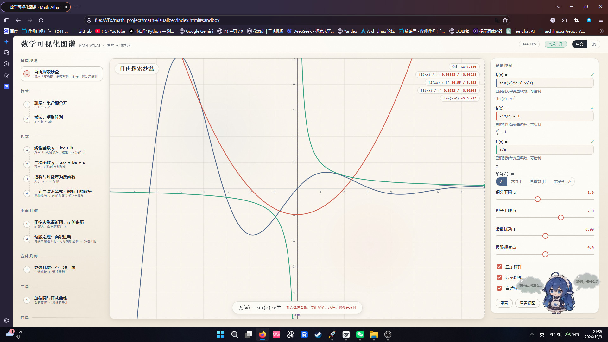

# Math Viz Atlas · 数学可视化图谱

> **Interactive mathematical visualization atlas built with DeepSeek Harness.**
> 一个用 DeepSeek Harness 构建的交互式数学可视化图谱。

[](https://pystay.github.io/math-viz-atlas/)
[](LICENSE)
[](https://github.com/pystay/math-viz-atlas/actions/workflows/ci.yml)
[-CE5848?style=flat-square)](#技术栈)
[](#构建)

从 **算术 → 初高中（代数 / 平面几何 / 立体几何 / 三角 / 向量 / 圆锥曲线 / 数列 / 统计）→ 大学基础微积分**
的交互式数学可视化应用，覆盖 **19 个可视化模块**，运行在**零构建、零后端、零 CDN** 的静态架构上。

它的核心是一条 **「自由输入 → 实时解析 → 动态渲染」** 的即时反馈回路：输入任意函数表达式，
<100ms 内完成解析、错误定位、LaTeX 回显与绘图；沙盒里对任意函数可直接**求导、求原函数、求定积分、
求极限**并即时画出结果，还能逐项展示**变量替换过程**与所用法则。



## 🎬 演示

<video src="docs/media/demo.mp4" controls muted loop playsinline width="100%"></video>

> 若上面的播放器在你的环境不可用，请直接下载观看：[docs/media/demo.mp4](docs/media/demo.mp4)（1920×1080 · 60fps · 5.3s · 3.8MB）

更多实拍见 [docs/media/](docs/media/)。

打开即用，无需登录、无需安装。也可以克隆到本地后**直接双击 `index.html`**（`file://` 亦可运行）。

## 功能

| 类别 | 能力 |
|---|---|
| **自由输入沙盒** | 任意单变量表达式实时解析与绘制；隐式乘法（`2x`、`(x+1)(x-1)`）、右结合幂（`2^3^2=512`）、科学计数法、分数幂；实时错误定位（指出第几个字符）；KaTeX 公式回显；三曲线叠加对比；可拖动/键盘驱动的探针（坐标 + 切线斜率 + 导数值）；滚轮缩放 |
| **沙盒微积分引擎** | 对用户输入的函数即时执行：符号**求导 f′**（虚线画出导函数）、**原函数 ∫f**、可调上下限的**定积分 ∫ₐᵇ**（24 个中点矩形 + 辛普森参考值）、**数值极限**（双侧逼近，判定存在/发散/左右不等）、**常数扰动 ε**（观察极值与渐近线如何移动）、**变量替换过程**（按顶层加减拆项，逐项给出导数与法则：幂函数/乘积/商/链式） |
| **19 个可视化模块** | 算术（集合并、矩形阵列）→ 代数（线性、二次、指数对数、一元二次不等式）→ 平面几何（圆、勾股）→ 立体几何（点线面透视投影）→ 三角（单位圆展开成正弦曲线）→ 向量（平行四边形法则）→ 圆锥曲线 → 数列（等差、等比、调和）→ 统计（直方图）→ 微积分（导数、定积分）。**详见下方[第二节知识覆盖表](#二知识覆盖19-个模块全学段)** |
| **自动演示系统** | 7 个核心章节配结构化叙事动画（① 引入 → ② 定义 → ③ 动态推导 → ④ 结论 → ⑤ 暂停交还用户）；支持播放/暂停、0.5×/1×/2× 倍速、可拖拽进度条、空格键；**用户随时可介入**——拖动任意滑块即暂停演示并接管 |
| **动效系统** | 重置回退（420ms 逆向缓动，"时间倒流"）、模块切换的相机过渡、曲线描边生成、背景活力层（24s 周期低对比度光斑） |
| **概念闭环** | 每个模块都展示「定义 / 几何意义 / 代数操作 / 实际应用」四个维度 |
| **响应式与无障碍** | 手机 / 平板 / 桌面三档布局；跳转链接、`role="tablist"`、`aria-invalid`、对比度 > 12:1；「减少动效」开关（跟随 `prefers-reduced-motion`），性能不足自动降级背景动效 |

## 技术栈

| 层 | 技术 | 说明 |
|---|---|---|
| 数学逻辑层 | **自研解析器**（词法分析 + 递归下降 + AST） | 零依赖；符号微分、化简、数值积分、统计与采样。纯函数、无 DOM，可直接在 Node 中测试 |
| 可视化渲染层 | **原生 Canvas 2D** | 手绘墨迹原语（种子化 PRNG + 低频谐波抖动）、逐像素采样 + **自适应递归二分**、DPR ≤ 2 |
| 交互层 | **原生 JS（IIFE 全局）+ CSS 设计令牌** | 无框架、无打包器；`localStorage` 仅存语言偏好 |
| 公式排版 | **KaTeX**（内联于 `vendor/`） | 无 CDN 请求 |
| 动效 | 自研补间管理器 + 时间轴引擎 | 无 GSAP / Framer Motion 等动画框架 |
| 测试与验收 | Node 断言 + **Chrome DevTools Protocol** 探针 | 314 条单元断言 + 帧率/墨迹/布局/沙盒/动效/演示端到端实测 |
| CI / 部署 | **GitHub Actions（CI）+ GitHub Pages（分支部署）** | push / PR 跑单元测试；Pages 从 `main` 根目录发布（配 `.nojekyll`） |

**运行时依赖：0 个**（KaTeX 已内联）。唯一的外部 npm 依赖是构建期的 KaTeX，仅用于将来重新内联。

## 本地运行

```bash
git clone https://github.com/pystay/math-viz-atlas.git
cd math-viz-atlas
```

- **方式一（推荐）**：直接双击 `index.html`。无需构建、无需服务器，`file://` 下所有功能可用。
- **方式二**：起一个静态服务器（便于测试相对路径与 Service Worker 类特性）：

  ```bash
  npx serve .        # 或 python -m http.server 8080
  ```

跑测试（需要 Node 18+）：

```bash
node src/core/math-core.test.js    # 76 条
node tests/modules.test.js         # 182 条
node tests/motion.test.js          # 29 条
node tests/timeline.test.js        # 27 条
```

浏览器端到端探针（本机需安装 Chrome，会自动启动无头实例）：

```bash
node tests/sandbox-probe.mjs       # 输入→解析→定位→渲染→探针（含 <100ms 计时）
node tests/motion-probe.mjs        # 回退 / 中断 / 相机过渡 / 描边 / 活力层 / 无障碍
node tests/demo-probe.mjs          # 自动演示播放器 + 沙盒微积分
node tests/fps-probe.mjs           # 19 个模块的帧率与运行时错误
node tests/layout-probe.mjs 390 844 sandbox   # 窄屏布局
```

## 构建

**没有构建步骤**——这是刻意的设计约束（依赖最小化、可离线、可双击运行）。

- 所有源码以经典 `<script>` 标签按依赖顺序加载，模块通过 IIFE 挂到全局（`window.MS` / `MathCore` / `Plot` / `Motion` / `Timeline`）。
- 新增第三方库时必须内联到 `vendor/`，不允许运行时 CDN 请求。
- 需要重新内联 KaTeX 时：`npm install katex@latest`，然后拷贝其 `dist/` 到 `vendor/katex/`。

## 部署

本项目使用 GitHub Pages 的 **Deploy from a branch** 模式：`main` 分支的根目录就是站点根目录。

**首次启用（一次性点击）**：

`Settings → Pages → Build and deployment → Source = Deploy from a branch`
→ Branch 选 **`main`**、目录选 **`/ (root)`** → **Save**。
约 1 分钟后 <https://pystay.github.io/math-viz-atlas/> 即可访问。

**为什么必须有 `.nojekyll`**：分支部署默认会用 Jekyll 处理站点，而 Jekyll 的默认排除列表里包含 `vendor/`，
会把内联的 KaTeX（`vendor/katex/`，81 个文件）从产物中丢掉，导致**公式渲染全部 404**。
仓库根目录的空文件 `.nojekyll` 让 Pages 原样发布文件——这不是可选项，是必需的。

**日常更新与重新部署**：

```bash
git add .
git commit -m "fix: ..."
git push origin main
```

推送后 Pages 会自动重建，约 1 分钟线上生效。**无需任何额外命令或构建步骤。**

**质量闸门**：[`.github/workflows/ci.yml`](.github/workflows/ci.yml) 在 push / PR 时运行 4 个单元测试套件
（314 条断言）。它**只做校验、不参与部署**——浏览器端到端探针（`tests/*-probe.mjs`）硬编码了 Windows 下的
Chrome 路径，只适合本地运行，故不纳入 CI。

**可选：改用 GitHub Actions 部署**（好处是只发布 `index.html`/`assets`/`src`/`vendor`，不暴露 `tests/` 与 `.github/`）：
把 Source 改成 `GitHub Actions`，并恢复一个使用 `actions/configure-pages` + `actions/upload-pages-artifact` +
`actions/deploy-pages` 的 workflow。注意：`GITHUB_TOKEN` **无法为新仓库创建 Pages 站点**（会报
`Resource not accessible by integration`），所以即使走 Actions 路线，首次也要手动在 Settings 里开启一次。

## 目录结构

```
math-viz-atlas/
├─ index.html                  # 唯一入口：脚本按依赖顺序加载，含 window.MS 注册表与启动错误面板
├─ assets/
│  ├─ tokens.css               # 设计令牌（色板 / 字体 / 间距 / 动效节奏）——复刻自参考视频
│  └─ app.css                  # 布局与组件样式（含响应式与打印样式）
├─ src/
│  ├─ core/
│  │  └─ math-core.js          # ① 数学逻辑层：词法/语法分析、符号微分、化简、LaTeX、积分、统计
│  │  └─ math-core.test.js     #    76 条断言
│  ├─ render/
│  │  ├─ sketch.js             # ② 渲染层：手绘墨迹原语（种子随机、抖动线条、纸纹）
│  │  ├─ plot.js               #    绘图引擎：坐标变换、网格、自适应采样、描边揭示、活力层
│  │  ├─ motion.js             #    动效引擎：缓动 + 可重定向补间
│  │  └─ timeline.js           #    演示时间轴：叙事步骤、进度、倍速、追赶语义
│  ├─ ui/
│  │  ├─ app.js                # ③ 交互层：路由、控件、公式/读数、探针、动画循环、无障碍
│  │  └─ i18n.js               #    中英词条
│  └─ modules/                 # 章节模块（组合三层）：sandbox + 18 个主题 + demos.js 演示脚本
├─ vendor/katex/               # 内联的 KaTeX（含字体），无 CDN
├─ tests/                      # 单元测试 + CDP 端到端探针 + 独立验证脚本与报告
├─ docs/media/                 # 演示录屏与截图（README 引用）
├─ .github/                    # CI workflow（单元测试）/ Dependabot / issue 与 PR 模板
├─ .nojekyll                   # 让 Pages 原样发布（否则 Jekyll 会丢掉 vendor/katex）
├─ CHANGELOG.md  CITATION.cff  CONTRIBUTING.md  SECURITY.md  CODE_OF_CONDUCT.md
└─ LICENSE                     # MIT
```

## 数据说明

- **不采集任何数据**：无后端、无账户、无埋点、无分析统计，不上传用户输入。
- **无远程请求**：KaTeX 与字体全部内联于 `vendor/`，**断网可用**；打开 DevTools 的 Network 面板可以看到没有任何外部请求。
- **唯一持久化**：`localStorage` 中的界面语言偏好（可随时清除，不影响功能）。
- **可复现的随机**：统计模块的正态样本由**种子化 PRNG**（mulberry32）生成，历史数据固定，因此每次打开看到同样的直方图；手绘抖动同样由固定种子驱动。
- **演示素材**：`docs/media/demo.mp4` 为本机录屏（1920×1080 / 60fps / 5.3s），仅包含应用界面，不含个人信息；`docs/media/screenshot-sandbox.png` 为界面截图。
- **示例数据**：下载的默认区间（如 `sin(x)*x^(1/4)`）与统计模块的样本均值/标准差均为**程序生成的示例**，不含任何真实用户数据。

## 贡献

欢迎贡献！请先阅读 [CONTRIBUTING.md](CONTRIBUTING.md) 与 [CODE_OF_CONDUCT.md](CODE_OF_CONDUCT.md)。

- 🐛 报告缺陷 → [Bug 报告模板](.github/ISSUE_TEMPLATE/bug_report.yml)（请附最小可复现输入）
- ✨ 功能建议 → [功能建议模板](.github/ISSUE_TEMPLATE/feature_request.yml)
- 🔐 安全问题 → 请勿公开提交，见 [SECURITY.md](SECURITY.md)

提交 PR 前请确保四个单元测试套件全绿（314 条断言），涉及数学计算的改动必须补充测试用例。

## 许可证

本项目采用 [MIT License](LICENSE) 发布。

```
Copyright (c) 2026 pystay
```

## 致谢

- **[DeepSeek Harness](https://github.com/deepseek-ai)** —— 本项目的全部实现均在 DeepSeek Harness 中完成。
- **参考视觉素材** —— 手绘白板风格的配色、线条与动效节奏复刻自用户提供的物理原理演示视频。
- **[KaTeX](https://katex.org/)** —— 公式排版引擎（MIT License，已内联于 `vendor/katex/`）。
- **[Contributor Covenant](https://www.contributor-covenant.org)** —— 行为准则文本。
- **独立对抗性验证** —— 本项目的两轮第三方只读审查（报告见第六节）发现了多个自测无法覆盖的缺陷，
  这种"挑刺"是代码质量的重要来源。

---

# 技术文档

以下为完整技术文档：架构、知识覆盖、验收数据、独立评审记录、动效与演示系统规范、已知边界。

## 一、快速开始

```
双击 index.html
```

或者在项目目录内起一个静态服务器（任意静态服务器均可）：

```powershell
cd D:\math_project\math-visualizer
& "D:\Program Files\nodejs\node.exe" -e "const h=require('http'),f=require('fs'),p=require('path');h.createServer((q,s)=>{let u=decodeURIComponent(q.url.split('?')[0]);if(u==='/')u='/index.html';const fp=p.join(process.cwd(),u);f.readFile(fp,(e,d)=>{if(e){s.writeHead(404);return s.end()}const t={'.html':'text/html','.js':'text/javascript','.css':'text/css','.woff2':'font/woff2'}[p.extname(fp)]||'application/octet-stream';s.writeHead(200,{'content-type':t});s.end(d)})}).listen(8080,()=>console.log('http://127.0.0.1:8080'))"
```

操作方式：

| 操作 | 说明 |
|---|---|
| 点击左侧知识地图 | 切换模块（对应 URL hash，如 `#calc-derivative`，可直接分享/截图） |
| **自由沙盒输入框** | 输入任意表达式：即时解析、✓/✗ 状态、**出错字符定位**、LaTeX 回显 |
| 拖动滑块 | 实时改变参数，图形立即更新（统一走 rAF，一帧内多次改动只重绘一次） |
| 画布探针 | 在沙盒里移动鼠标（或聚焦画布后按 ←/→），实时显示各曲线的 $f(x_0)$ 与 $f'(x_0)$ |
| 画布滚轮 | 沙盒内缩放（围绕光标）；「重置视图」恢复 |
| 键盘 | 滑块聚焦时 `←/→` 微调；`[` `]` 切换上一/下一模块；`P` 切换动画开关；`Tab` 顺序遍历 |
| `中文 / EN` | 切换界面语言（数学符号保持国际标准，不随语言变化） |
| `重置` | **带回退动画**地恢复默认参数（420ms 逆向缓动，见第七节） |
| `动效：开/关` | 关闭背景活力层与过渡动画（无障碍；系统 `prefers-reduced-motion` 也会自动触发） |

### 输入语法（沙盒）

| 能力 | 例子 |
|---|---|
| 隐式乘法 | `2x`、`(x+1)(x-1)`、`3sin(x)` |
| 右结合幂 | `2^3^2 = 512` |
| 内置函数 | `sin cos tan asin acos atan sinh cosh tanh exp ln log log2 sqrt abs sign floor ceil round min max` |
| 常数 | `pi`、`e` |
| 科学计数法 / 分数幂 | `1e-3`、`x^(1/3)`（负半轴按实根计算：`(-8)^(1/3) = -2`） |
| 错误定位 | `x^2 + si(x)` → 「未定义的函数或变量：si」，并在下方用 `^` 标出第 6 个字符 |

---

## 二、知识覆盖（19 个模块，全学段）

| 学段 | 模块 | 可视化核心 |
|---|---|---|
| 沙盒 | 自由探索沙盒 | 任意表达式 → 实时解析/报错定位/LaTeX 回显/多曲线/探针/缩放 |
| 小学·算术 | 加法（集合并）、乘法（矩形阵列） | 对象合并与阵列计数，先给动作再给算式 |
| 初中·代数 | 线性函数、二次函数、指数对数、**一元二次不等式** | 斜率三角形、顶点判别式、**数轴上的解集区间与端点开闭** |
| 初中·平面几何 | 正多边形逼近圆、**勾股定理面积证明** | 内接/外切夹逼 π、三块正方形与单位方格 |
| 高中·立体几何 | **点线面：正方体/正四面体/正八面体** | 三维旋转 + **透视投影**、画家算法遮挡、欧拉 V−E+F |
| 高中·三角 | 单位圆与正弦曲线 | 旋转"铺开"成波浪，等高线严格对应 |
| 高中·向量 | **向量加法与数量积** | 平行四边形法则、分量分解、夹角弧 |
| 高中·解析几何 | **圆锥曲线（离心率统一定义）** | e 连续变化：椭圆→抛物线→双曲线，\|PF\|/\|PL\| = e |
| 高中·数列 | **等差数列**、几何级数、调和级数 | 通项直线与部分和阶梯；收敛 vs 发散 |
| 初中·统计 | **直方图与箱线图** | 密度直方图 + 正态曲线 + 五数概括箱线图与离群点 |
| 大学·微积分 | 导数（割线→切线）、定积分（黎曼和） | h→0 动画、正负面积分色与代数和 |

---

## 三、架构（三层分离，规则要求）

```
math-visualizer/
├─ index.html                  # 外壳：只声明画布/面板容器与脚本加载顺序
├─ assets/
│  ├─ tokens.css               # 设计令牌：色板/字号/间距/圆角/阴影/缓动/纸纹
│  └─ app.css                  # 布局与组件样式（全部引用令牌，无硬编码颜色）
├─ src/
│  ├─ core/math-core.js        # ① 数学逻辑层：词法/语法/求值/符号求导/化简/LaTeX/积分/统计
│  ├─ core/math-core.test.js   #    数学正确性验收（76 项断言）
│  ├─ render/sketch.js         # ② 渲染层：手绘墨迹原语（种子随机）
│  ├─ render/motion.js         #    渲染层：动效引擎（缓动 + 可重定向补间）
│  ├─ render/timeline.js       #    渲染层：自动演示时间轴（步骤/进度/倍速/追赶语义）
│  ├─ render/plot.js           #    渲染层：坐标变换/网格/自适应采样/描边揭示/活力层
│  ├─ modules/                 #    模块层：把「数学 + 绘制 + 说明」组合成概念页
│  │  ├─ sandbox.js            #      自由输入沙盒（3 槽位 + 探针 + 缩放）
│  │  ├─ arithmetic.js  algebra.js  algebra2.js
│  │  ├─ geometry.js    geometry2.js  (平面几何 / 立体几何)
│  │  ├─ trig.js        trig2.js      (单位圆 / 向量)
│  │  ├─ calculus.js    series.js     stats.js
│  └─ ui/
│     ├─ i18n.js               # ③ 交互层：国际化
│     └─ app.js                #    交互层：路由/控件/公式/读数/探针/动画循环/无障碍
├─ tests/
│  ├─ modules.test.js          # 模块层回归（140 项断言）
│  ├─ motion.test.js           # 动效引擎单元测试（29 项）
│  ├─ bench.js                 # 数学层性能基准
│  ├─ fps-probe.mjs            # 19 个模块的真实帧率 + 运行时错误 + 画布内容自检（CDP；支持 nomotion A/B）
│  ├─ motion-probe.mjs         # 动效端到端：回退/中断/相机过渡/描边/活力层/无障碍开关
│  ├─ sandbox-probe.mjs        # 沙盒端到端：输入→解析→定位→渲染→探针（含 <100ms 计时）
│  ├─ layout-probe.mjs         # 窄屏真实视口布局诊断 + 截图
│  ├─ verify/                  # 第一轮独立对抗性验证脚本（v1..v6）
│  └─ verify2/                 # 第二轮独立验证脚本（v1..v8 + REPORT.md）
└─ vendor/katex/               # 本地化的公式排版引擎（含字体）
```

**依赖方向是单向的**：`modules → core + render`，`ui → modules`。
数学层不依赖 DOM（可在 Node 里跑测试），渲染层不知道任何数学定义，
交互层不做任何数学计算——这也是能对三层分别验收的原因。

### 统一模块契约

每个概念页就是一个纯数据 + 两个函数的对象，`ui/app.js` 只认这个契约：

```js
MS.register({
  id, stage, order,
  title, caption,                 // 双语标题/副标题
  formula(params) -> latex,       // 公式卡（KaTeX 渲染）
  controls: [...],                // range / segment / toggle
  view(params) | square(params),  // 视窗（square 保证圆是圆、y=x 是 45°）
  init(state), animate(state, params, dt), draw(plot, params, state),
  readouts(params, state),        // 顶部实时读数
  legend: [...],
  info: { definition, geometry, algebra, application }   // 概念闭环四维
});
```

新增一个概念只需新增一个模块文件并在 `index.html` 里加一行 `<script>`，
不需要改动任何其它文件——这就是「便于后续扩展线性代数/拓扑」的落点。

---

## 四、概念闭环（规则要求：定义 / 几何意义 / 代数操作 / 实际应用）

每个模块右侧都有四个标签页，内容与图形联动，例如导数模块：

- **定义**：$f'(x_0)=\lim\limits_{h\to 0}\dfrac{f(x_0+h)-f(x_0)}{h}$
- **几何意义**：红割线 → 绿切线，$h\to0$ 的两点重合过程
- **代数操作**：页面显示的 $f'(x)$ 由**符号求导**精确给出（如 $x^3\to 3x^2$），不是数值差分
- **实际应用**：速度/边际成本/梯度下降

---

## 五、验收结果（全部可复现）

### 1. 数学正确性：核心 76 + 模块 182 + 动效 29 + 时间轴 27 = 314 条断言全通过

```powershell
& "D:\Program Files\nodejs\node.exe" src/core/math-core.test.js   # 76 条：解析/求导/积分/级数/统计/LaTeX 语义/定义域护栏
& "D:\Program Files\nodejs\node.exe" tests\modules.test.js        # 182 条：19 个模块 + 沙盒微积分 + 演示脚本结构
& "D:\Program Files\nodejs\node.exe" tests\motion.test.js         # 29 条：缓动端点/时长/重定向/取消/并行补间
& "D:\Program Files\nodejs\node.exe" tests\timeline.test.js       # 27 条：叙事推进/自动暂停/倍速/定位/脚本容错
```

覆盖：运算优先级与幂右结合、隐式乘法、函数元数校验、**符号求导公式**、
**符号求导 vs 数值导数交叉验证（14 个函数，最大相对误差 3.3e-10）**、
黎曼和收敛与单调夹逼、辛普森积分、正负面积代数和语义、级数收敛/发散、边界值，
以及独立评审后新增的两组回归测试：**LaTeX 输出语义等价**、**化简的定义域护栏**。

### 2. 性能：数学层占用 0.29% 帧预算

```powershell
& "D:\Program Files\nodejs\node.exe" tests/bench.js
```

| 热路径 | 耗时 |
|---|---|
| 曲线采样 1440 点（每像素一列） | 0.025 ms |
| 黎曼和 n=80 | 0.0044 ms |
| 辛普森参考值 n=2000 | 0.0143 ms |
| 调和级数 n=500 | 0.0041 ms |
| **一帧最坏合计** | **0.048 ms（16.67ms 预算的 0.29%）** |

### 3. 真实帧率：19 个模块全部 60 FPS，0 长帧

```powershell
& "D:\Program Files\nodejs\node.exe" tests\fps-probe.mjs
```

在无头 Chrome、`--disable-gpu`（纯软件光栅，比低端设备更严苛）、1440×900 下实测：
最低 60 FPS、长帧（>20ms）总数 0、最差单帧 16.8ms —— 远高于「低端设备 ≥30FPS」的约束。
同一次运行还会校验**运行时错误面板为空**、**每个模块的画布墨迹覆盖率 > 0.5%**
（防止某个模块 draw 抛错后静默留白）。

### 3b. 自由输入沙盒端到端（含「<100ms 即时响应」验收）

```powershell
& "D:\Program Files\nodejs\node.exe" tests\sandbox-probe.mjs
```

| 检查项 | 实测 |
|---|---|
| 非法输入 `x^2 + si(x)` | ✗ 状态 + 「未定义的函数或变量：si」 |
| 错误字符定位 | 插入符行 `      ^` 指向第 6 个字符（`si` 的 `s`） |
| 无障碍标记 | `aria-invalid="true"` + `.invalid` 样式 + 关联 `aria-describedby` |
| 合法输入 `x^3 - 3x` | ✓ 状态 + KaTeX 回显 + 错误提示消失 |
| **输入 → 首帧渲染** | **25.9 ms**（解析本身约 0.01 ms，其余是两帧 rAF） |
| 键盘探针（`←/→`） | 读数由 `x₀ 1.2 / f′ 1.32` 变为 `x₀ 3.2 / f′ 27.72` |
| 多曲线绘制 | 墨迹覆盖率 7.1%，三个槽位颜色互不相同 |

### 4. 视觉验收：13 张模块截图

`shots/*.png`（由无头 Chrome 逐模块实拍，非示意图）。
图中可见：淡网格纸底、手绘抖动连线与墨迹圆、珊瑚/钴蓝双色语汇、
公式卡（KaTeX）、实时读数胶囊、知识地图的手绘虚线脉络。

### 5. 窄屏（真机尺寸）验收

```powershell
& "D:\Program Files\nodejs\node.exe" tests/layout-probe.mjs 390 844
```

用 CDP `Emulation.setDeviceMetricsOverride` 设定**真实 390×844 视口**（而不是 `--window-size`：
无头 Chrome 的窗口宽度有约 500px 下限，直接用小窗口会截出"被裁切"的假象——这个坑本身就是一次
误判，已在 README 中记录）。实测结果：**无水平溢出**（scrollWidth 390 = 视口 390）、
读数胶囊自动换成 **2 行**、最后一个胶囊右边缘 158px < 390px，截图 `shots/mobile-layout.png`。

---

## 六、独立对抗性评审（第三方验证，已闭环）

数学引擎与 11 个模块由一位**独立验证者**（不同上下文、只读权限、不得修改 `src/`）对抗性审查，
自行编写了 6 个验证脚本（`tests/verify/v1..v6`，共 **21 243 项检查**），
刻意尝试证伪：符号求导闭式核对、解析器陷阱、化简模糊测试（fuzz 比对化简前后取值）、
LaTeX 语义等价（把显示式**独立翻译回 AST**再逐点比价）、以及全部模块的公式/读数一致性。

### 5.1 引擎层缺陷（已修复）

| 严重度 | 问题 | 修复 |
|---|---|---|
| **high** | `toLatex` 对一元负号不加括号：`(-x)^2` 显示成 `-x²`——**显示式与表达式符号相反** | 括号判断改为在 `toLatex` 最外层统一执行，一元/函数节点同样适用；底数按 `p+1` 传入 |
| medium | `(x^2)^3` 输出 `x^{2}^{3}`，KaTeX 直接拒绝渲染（非法 LaTeX） | 同上，连续幂的底数强制加括号 |
| medium | 化简把 `0·ln(x)`、`0/x`、`0·sqrt(x)` 一律折叠成 `0`，**掩盖了 NaN/∞** | 新增定义域护栏 `isTotal()`：只有"对一切实数有定义"的因子才允许 `0·X → 0`；`0/X → 0` 仅当分母是非零常数 |
| medium | 常数系数合并未做溢出检查，`10^300·(10^300·x)` 合并出 `Infinity` | 合并前加 `isFinite` 护栏 |
| low | `compile` 遇到未绑定变量静默返回 `undefined/NaN`，与 `evaluate` 抛错行为不一致 | 变量访问改为抛 `ReferenceError`，两条路径行为对齐 |
| low | `x(x+1)` 被误判为"未知函数调用"而报错（数学手写常见记号） | 仅当标识符是**已知函数名**时才解析为函数调用，否则走隐式乘法 |
| low | 不支持科学计数法 `1e3` | 词法层支持（`2e` 仍正确解析为 `2·e`） |
| low | `formatNumber` 把 `1e-13` 显示成 `0`（误差读数出现 100% 相对偏差） | 极小非零量改用科学计数法输出；另加 `formatFixed()` 供参数显示 |
| low | `d/dx((-2)^x)` 输出含 `ln(-2)` 的假公式 | 负常数底数 + 变量指数时显式抛"实数域不可导" |
| low | `(-8)^(1/3)` 返回 NaN（JS `Math.pow` 语义），实根应为 −2 | 新增 `powReal()`：分母为奇数的有理指数按实根计算 |
| low | `x-(-x)` 显示为 `x - -x`（悬挂负号） | 一元负号作右操作数时加括号 |

### 5.2 模块层缺陷（已修复，`tests/modules.test.js` 逐条钉死）

| 严重度 | 问题 | 修复 |
|---|---|---|
| **high** | 二次函数 `a=0` 时**三处自相矛盾**：公式按 `a=0` 显示成直线、读数按被夹紧的 `a=0.02` 算出顶点/判别式、"开口"却按 `a=0` 判成"向下" | 删除"夹紧成小抛物线"的伪装：`a=0` 时统一为直线，公式/绘图/读数/"开口"四处口径一致（开口显示 `—`、判别式显示 `不适用`） |
| medium | 几何级数 `r=1` 时显示 `(1-1ⁿ)/(1-1)` = **0/0**；`r=1.01~1.04` 因有效数字显示成 `1`，`1.05` 显示成 `1.1` | `r=1` 时改显示真实部分和 `S_n = n` 并标注发散；参数显示改用定点格式化，`1.05` 就是 `1.05` |
| medium | 指数/对数模块底数 `a=1` 可达，却仍声称"互为反函数"，并硬编码 `logₐa=1`、`logₐ1=0` | `a=1` 时明确写出"`1ˣ ≡ 1` 非单射 → 无反函数，`log₁x` 无定义"，只绘制 `y=1` |
| medium | 导数模块选 `ln(x)` 时切点 `x₀` 仍可取负值：割线斜率是 NaN，却仍显示有限的"切线斜率" | 切点范围随函数变化（`ln` 时 `x₀ ≥ 0.1`）；并加定义域护栏，越界时读数显示"定义域外" |
| medium | 定积分 `a > b` 时**静默交换上下限**：数值符号与 `∫_a^b` 相反，画布还把较小端点标成 "a" | 保持用户给定的方向（反向积分结果为负），画布标注"b < a：反向积分"，并把"正/负面积"按几何意义与"代数和"分开统计 |
| low | 被积函数选 `ln(x)` 且 `a<0` 时读数直接是 NaN | 非有限值时显示"定义域外"并给出区间提示 |
| low | π 读数是硬编码字符串 | 改为 `formatNumber(Math.PI, 7)`，并补充外切误差 |
| low | 余项估计 `\|r\|ⁿ/(1-\|r\|)` 在 `r<0` 时比真余项松 19 倍 | 改用精确余项 `\|rⁿ/(1-r)\|` |
| low | 三角模块公式用 2 位**有效数字**，`A=1.05` 显示成 `1.1`（显示参数 ≠ 绘图参数） | 全部参数改用 `formatFixed()`（按小数位，与滑块 step 对齐） |

复跑结果：`v1` 517 项 0 失败；`v2` 134 项 0 问题；`v4` 110 项 0 问题；
`v3` 模糊测试的问题数从 **9/800 降到 1/800**。

**剩余条目经逐条核实均为"夹具过期"或"不可避免的浮点边界"**，如实记录（不改测试去凑绿）：

1. **`v5` 仍报 13 条模块问题——这是它按修复前的行为写死的判据，不是未修复的缺陷。** 证据就在它自己的输出里：
   - 它打印 `显示=—`（这正是修复后的正确值），判据却是 `if (读数 !== '向上') 报错`——它不知道 `a=0` 已按"退化为直线"处理；
   - 它打印 `切线斜率 f′(x₀)=定义域外`（修复后的正确值），判据仍按"必须是个有限数"检查；
   - 它按 `a>b` 一律报"静默交换上下限"，而现在的实现是**保留方向的反向积分**（数值为负、画布标注方向），判据未区分"交换"与"反向"；
   - 它列出的 `r 列表: 1.01→1, 1.05→1.1` 是它自己用 `formatNumber` 复算的旧映射，而非读取模块现在的输出（模块现在输出 `1.01` / `1.05`）。
   权威回归以 `tests/modules.test.js` 的 46 条断言为准（逐条对应这 13 项发现，全部通过）。
2. `v4` 第 8 节使用**硬编码**的期望串（脚本自身写死 `tex: '-x^{2}'`），未调用引擎；
3. `v2` 仍期望 `(-8)^(1/3)` 为 NaN、`v4` 仍期望 `x-(-x)` 不加括号——恰好是本轮修复的目标行为，夹具未同步；
4. `v6` 剩余 6 例全部是 `0·exp(1000)` 这类**未化简式的 IEEE 溢出**（`e^1000 = Infinity` → `0·Infinity = NaN`），化简结果 `0` 在实数意义下才是正确的；
5. `v3` 剩余 1 例是 `x^0/((x)·0)` 这类**处处无定义**的表达式在 `1/0` 上出现 `-0` 与 `+0` 之差（`-∞` vs `∞`），属 IEEE 浮点符号零。

> 这次评审的价值正在于：这些缺陷**不会**被"自己写的测试"发现——因为自测和实现共享同一套理解。
> 其中 `a=0` 那条最典型：公式、绘图、读数各自都"看起来没错"，**只有交叉比对才暴露矛盾**。

### 6.2 第二轮独立评审（针对本轮新增的 8 个模块）

新模块交给**另一位独立验证者**（同样只读权限、只写 `tests/verify2/`）对抗性审查，
共 8 个脚本：不等式解集**枚举 10 万余用例 + 132 万采样点暴力比对**、圆锥曲线半轴拟合、
向量、统计（对照其自写的独立实现）、勾股、立体几何（旋转矩阵 + 画家算法）、数列、解析器边界。

**找到并已修复的真实缺陷：**

| 严重度 | 问题 | 修复 |
|---|---|---|
| **high** | 一元二次不等式 `a = 0`（滑块可达）时 `solveQuad` 除以 0 → 解集变成 `NaN` /「(−∞, NaN)」，而读数却写"不是二次" | 增加**一次不等式分支**（含 b=0 的常数情形）；±∞ 端点一律用开括号（`[−∞` 是错误写法） |
| **high** | 勾股定理：b 边正方形用错有向边（`A→C`），正方形画到**三角形内部**并与斜边正方形重叠 | 改用 `C→A`——三角形按 A→B→C 逆时针给出，"边向量顺时针转 90°"才统一朝外 |
| medium | "单位方格"实际按**面积×面积**分格（3² 的方块画成 9×9、格边长 1/3） | 改为传**边长**：每边 n 格、格边长恰为 1，格子总数 = 面积 |
| medium | 双曲线**只画出一支**（`r < 0` 的点被丢弃） | 允许负 `r`（负号对应的正是另一支），只对 `\|r\| > 40` 断笔 |
| medium | `e = 0.98 / 1.02` 因 `\|e−1\| < 0.02` 的容差被判成抛物线 | 判据收紧到 `1e-9`：0.98 是椭圆、1.02 是双曲线 |
| low | 零向量夹角显示字面量 `NaN°` | 显示"未定义（零向量）"，并抹掉 0°/180° 附近的浮点噪声 |
| low | 输入前导空格使**插入符定位错位**（index 相对 trim 后的串） | `parseSafe`/`toFunctionOfX` 统一补偿前导空白偏移 |
| low | 等差数列文案把折线称作"部分和阶梯" | 改为"部分和曲线 Sₖ"（图形与文案一致） |

**剩余条目核实结果（第三批：验证者最终报告里的 3 项，已全部修复）**

| 严重度 | 问题 | 修复 |
|---|---|---|
| medium | `persp = 0` 标为「正交投影」但实为强透视（`D = 6−4·persp` → persp=0 时 D=6，缩放比 1.77×，平行棱差 13.4%） | 改为 `D = 6 / persp`（persp→0 时 D→∞），`persp < 0.02` 时直接令缩放 `s ≡ 1`，这才是真正交 |
| medium | `x^(1/3)` 因指数写成**分数**（AST 里是除法节点）而走了"一般幂指"分支，产生 `0·ln(x)` → 在 x<0 符号导数为 NaN（探针斜率与切线消失） | 求导前先用 `constValue()` 判断指数是否为常数；是则走幂函数法则（并保留 `\frac{1}{3}` 的分数写法）。`x^(1/3)` 在 x=−3 处现在给出 **+0.1602**（真值 (1/3)·\|x\|^(−2/3)） |
| low | 非整数边长时"单位方格"名不副实（a=1.5 → 2×2 格、格边长 0.75） | 仅在**边长为整数**时绘制单位方格，并更新开关文案与 info 说明 |

同批修掉的含糊项：三角模块图上角度与读数统一为 4 位有效数字；圆锥曲线「实测 \|PF\|/\|PL\|」改为**真实测量**（θ₀=62° 处计算，而非直接抄 e）；等差数列 info 里残留的"阶梯"措辞。

**`v6_solid` 复跑 144 项"不符"是夹具过期**：它的期望串写死 `D = 6/5/4/3/2`（即旧的 `D = 6−4·persp`），
而 `persp=0 → s≡1` 正是它自己在报告里给出的修复建议。本仓库 `tests/modules.test.js` 用
**逐点比对独立正交投影**（8 个顶点全部在 1e-6 内一致）验证了修复后的行为。
`v5` 剩余的"格子数"一项同理：判据用自己硬编码的 `(面积)²` 复算，而非测量模块的实际绘制。

---

## 七、动效系统（Motion System）

动效不是装饰，而是**解释状态的工具**。三类动效各有明确的触发时机与规范：

| 动效 | 缓动 / 时长 | 触发时机 | 实现位置 |
|---|---|---|---|
| **重置回退**（Reverse Easing） | `easeInOutCubic` · **420ms** | 点击「重置」 | `app.js resetAnimated()` + `render/motion.js` |
| **相机过渡** | `easeInOutCubic` · **380ms** | 切换模块（视窗连续插值，网格/坐标轴随之平滑变形） | `app.js tweenCamera()` |
| **曲线描边生成** | `easeOutCubic` · **650ms** | 切换模块 / 重置（reveal 0→1 裁剪揭示） | `plot.js setReveal()` |
| **背景活力层** | 周期 **24s**、alpha ≤ **0.05**、漂移 ≤ 6%、**15Hz** | 闲置时常驻 | `plot.js setAmbient()` |

**为什么这样设计**

- **回退用 `easeInOutCubic`**：起步与收尾都慢、中段快，视觉上像"时间倒流"而不是"弹回去"，
  帮助用户建立「状态复原」的心理模型；**参数修改绝不走这条路径**——规则要求输入到渲染 <100ms，
  所以描边/回退只在"重置"与"切模块"这类刻意时刻播放。
- **活力层低对比度 + 低频**：两团径向光斑以 24s 周期缓慢漂移（主网格同时做 ±13% 的极轻呼吸），
  幅度小到不会与曲线争夺注意力，只让画面"活着"。刷新节流到 **15Hz**——
  光斑 24s 才走一圈，15Hz 与 60Hz 在观感上无法区分，但省掉了 3/4 的无谓全画布重绘。
- **中断即接管**：用户在任何动画进行中拖动滑块，对应补间立刻 `cancel()`，输入即时生效、
  不回弹；而**目标被重新设定时**补间从"当前显示值"重新出发（`motion.to()` 的可重定向语义），
  所以动画中途切目标也不会跳变。

**无障碍与自动降级**

| 机制 | 行为 |
|---|---|
| 「动效」开关（顶栏） | 一键关闭：`aria-pressed=false`、`body.motion-off`（停掉 CSS 呼吸）、`ambientOn()` 返回 false |
| `prefers-reduced-motion: reduce` | 启动时自动跟随，无需用户操作 |
| 性能不足 | 连续 2 秒平均 < 45FPS 自动降级为静态背景（读数显示「已降级」）；用户手动设定过开关后不再自动干预 |
| 页面不可见 | `visibilitychange` 时暂停活力层，避免后台空转 |

**验证（真实浏览器实测）**

```powershell
& "D:\Program Files\nodejs\node.exe" tests\motion.test.js     # 动效引擎 29 条单元测试
& "D:\Program Files\nodejs\node.exe" tests\motion-probe.mjs   # 11 项端到端实测
```

| 检查项 | 实测 |
|---|---|
| 重置**经过中间值**而非瞬跳 | 滑块 `1.8 → 1.7（140ms 时）→ 1.0（默认值）` |
| 回退中用户再输入 → 立刻接管 | 用户设为 1.8 后 700ms 仍为 **1.8**（未被回退拉走） |
| 相机过渡连续 | 视窗 `yMin: -5 → -5.367 → -6`（三个采样点严格位于两端之间） |
| 曲线描边生成 | `reveal: 0.00 → 0.60 → 1.00` |
| 活力层真的在动 | 闲置 700ms 后画布像素签名改变 ✓ |
| 关闭动效后画面静止 | 签名不变 ✓，`body.motion-off` ✓，可再次开启 ✓ |

**动效性能（A/B 实测，软件光栅的保守下限）**

```powershell
& "D:\Program Files\nodejs\node.exe" tests\fps-probe.mjs            # 动效开启
& "D:\Program Files\nodejs\node.exe" tests\fps-probe.mjs nomotion   # 动效关闭（A/B 对照）
```

| 配置 | 最低帧率（多次测量） | 长帧（>20ms） |
|---|---|---|
| 动效开启（默认） | **51 – 60 FPS** | 2 – 19 |
| 动效关闭（减少动态效果） | **60 FPS** | **0** |

结论与说明：

- 动效全开时最差一次仍为 **51 FPS**，高于「低端设备 ≥30FPS」的硬约束；真实设备上 Canvas 走 GPU 合成，
  余量比这里的纯软件光栅大得多。无头 Chrome 的软件光栅在同一台机器上并发测量时会有波动（同一配置
  不同轮次可差 10FPS），因此这里给出区间而不是单点。
- 为把动效开销压下来做了两处工程优化：**① 活力层视觉刷新节流到 15Hz**（光斑 24s 才走一圈，
  15Hz 与 60Hz 观感无差别）；**② 过渡动画期间暂停绘制光斑**（此刻注意力在曲线与相机上，且已在逐帧重绘）。
- 如果设备仍然吃力，`app.js` 的自动降级会在连续 2 秒平均 <45FPS 时把活力层关掉（读数显示「已降级」），
  核心图表优先级始终最高。

---

## 八、沙盒微积分引擎（输入 → 微分/积分/极限 → 即时可视化）

沙盒不只是绘图器：用户在输入框里写下的**任意函数**都能立刻做微积分运算，结果当场画出来。

| 运算 | 数学实现 | 可视化 | 实测 |
|---|---|---|---|
| **求导 f′** | 符号微分（`math-core.diff` → 化简 → 编译） | 同色**虚线**画出导函数；探针显示 $f(x_0)$ 与 $f'(x_0)$ | `d/dx x^(1/3)` 在 x=−3 处 = **+0.1602**（真值 (1/3)\|x\|^(−2/3)） |
| **原函数 ∫f** | 数值积分 $F(x)=\int_0^x f$（辛普森 300 段） | 紫色虚线 + `F(0)=0` 标记 | $\int_0^2 t\,dt = 2$，$F(0)=0$，$F(-2)=+2$（定向积分） |
| **定积分 ∫ₐᵇ** | 24 个中点矩形 + 2000 段辛普森参考值 | 矩形 + 绿色上下限竖线 + 黎曼和/精确值读数 | $\int_0^2 x^2 dx \approx 8/3$（24 矩形误差 < 2e-3） |
| **极限** | h 递减序列（1e-1 … 1e-6）双侧逼近 | 观察点竖线 + 左右极限与判定读数 | $\lim_{x\to0}\frac{\sin x}{x}=1$；`1/x` 判**发散**；`\|x\|/x` 判**不存在**；$\lim_{x\to2}\frac{x^2-4}{x-2}=4$ |
| **常数扰动 ε** | `perturbConstants`（只缩放数值常数，**幂指数不动**，具名常量 pi/e 不参与） | 紫色虚线对照曲线 + `max\|Δf\|` 读数 | `x²+3` 扰动 10% → x=0 处取 3.3；指数不被扰动 |
| **变量替换过程** | `diffSteps`：按顶层加减拆项，逐项判定所用**法则** | 「代数操作」页逐行：`项 ⟶ 导数` + 法则标签 | `x³+sin x` → 幂函数法则 / 基本导数公式；`x·sin x` → 乘积法则；`sin(x²)` → 链式法则 |

---

## 九、自动演示系统（分章节叙事）

每个核心章节配一段结构化自动演示，遵循统一叙事：**① 引入 → ② 定义 → ③ 动态推导 → ④ 结论 → ⑤ 自动暂停交还用户**。

| 能力 | 实现 |
|---|---|
| 时间轴引擎 | `render/timeline.js`：步骤 =（文案 + 时长 + 缓动 + `apply(进度, 上下文)`），只做"时间 → 进度" |
| 播放控制 | ▶/❚❚、**0.5× / 1× / 2×** 倍速、**可拖拽进度条**定位、✕ 关闭、空格键切换 |
| 随时介入 | 任何控件输入 → 演示**立即暂停**并交由用户；引擎在暂停态**不再回写参数**（否则会覆盖用户刚拖的值） |
| 跳转一致性 | **追赶语义**：seek 或长帧跳跃会先把此前每一步按终值补应用，避免跳过中间步骤造成状态错乱 |
| 结束时 | 自动暂停并提示"演示结束，可自由探索"，按钮变「↻ 重播」 |
| 无障碍 | 「减少动效」开启时演示入口禁用，正在播放的演示会被关闭 |
| 脚本容错 | 脚本内抛错被捕获 → 暂停并交还用户，绝不让应用崩溃 |

已配脚本的 7 个章节（均在 `modules/demos.js`，总时长 9–11 秒）：

| 章节 | 叙事主线 |
|---|---|
| 三角函数 | 旋转点 → 纵坐标即 sin θ → ω 扫描（周期）→ φ 平移 → 结论 |
| 导数 | 两点 → 割线斜率 → **h → 0** → 割线变切线 → 拖动 x₀ 探索 |
| 定积分 | 面积问题 → 矩形近似 → **n 增大** → 改看中点法 → 拖动 n 看误差 |
| 圆锥曲线 | 焦点/准线 → 椭圆 → **e = 1 抛物线** → 双曲线两支 → 连续拖动 e |
| 几何级数 | 递推 → 部分和逼近 → **\|r\| < 1 收敛** → r ≥ 1 发散 |
| 二次函数 | 三要素 → 对称轴随 b → **判别式 2→1→0 个根** → 开口随 a 的符号 |
| 勾股定理 | 直角三角形 → 三块正方形 → 单位方格 → **a²+b²=c²** |

**端到端验收（`tests/demo-probe.mjs`，16 项全过）**

| 检查项 | 实测 |
|---|---|
| 启动与推进 | 播放器出现；x₀ 被脚本从 `1` 改写到 `-1.5`；进度条 84‰；标签「① 引入」 |
| 暂停 | 参数冻结（两次采样完全一致） |
| 倍速 | 2× 下 0.6s 实时推进 **1.1s** 时间轴 |
| 进度定位 | 拖到 70% → 标签跳到「④ 结论」 |
| **用户介入** | 拖动滑块后参数保持用户值 **1.75**，提示「演示已暂停：你接管了控制」 |
| 无障碍 | 减少动效 → 按钮禁用、点击不再弹出播放器 |
| 沙盒微积分 | 「求导」使画布墨迹 7.1% → **8.5%**（导函数确实被画出）；「定积分」→ 8.2%（矩形）；推导步骤面板 **2 行含法则标签** |

---

## 十、性能与降级策略（在代码中的位置）

| 策略 | 位置 | 说明 |
|---|---|---|
| **自适应采样** | `plot.js curve()` | 每像素一列 + 递归二分：中点偏离弦高 > 0.6px 才继续细分（最多 4 层），陡峭段与高振荡区自动加密，平坦区保持廉价 |
| **输入管线** | `ui/app.js` text 控件 | 每次输入只解析一次并缓存 AST；同一帧内的多次输入由 `dirty` 合并；KaTeX 重排只在参数变化时发生，动画帧只更新读数文本 |
| **缩放边界** | `plot.js zoomAt()` | 围绕光标缩放，视窗跨度限制在 1e-4 ~ 1e7，避免退化到 0 或溢出 |
| 曲线按像素列采样 | `plot.js curve()` | 采样量与画布宽度解耦，与缩放无关 |
| 自适应网格步长 | `plot.js niceStep()` | 每格约 64px，范围变化时自动降到 1/2/5×10ⁿ，避免网格过密 |
| DPR 上限 2× | `plot.js resize()` | 高 DPI 屏不至于爆填充率 |
| 渐进线断点 | `plot.js curve()` | 遇 `NaN/∞` 或跳变 >1.5 屏高即断笔，避免跨渐近线假连线 |
| 一帧一次重绘 | `app.js loop()` | 参数改动只置 `dirty`，rAF 统一重绘 |
| KaTeX 只在参数变化时重排 | `app.js loop()` | 动画帧只更新读数文本，不重排公式 |
| 尊重系统减弱动效 | `app.css` | `prefers-reduced-motion` 下关闭过渡 |

---

## 十一、无障碍

- 跳转链接（跳过导航直达主舞台）、`role="tablist"/"tab"/"tabpanel"`、`aria-pressed`、`aria-current`
- 全部控件使用原生 `<input type="range">/<input type="checkbox">/<input type="text">`，天然支持键盘与读屏
- `:focus-visible` 统一焦点环；正文色 `#20262F` 于 `#FBF7EF` 上对比度 > 12:1，强调色 `#B8453A` ≈ 5:1
- 画布语义：`<canvas role="img" aria-label="数学图形画布">`，关键数值同时以文本读数呈现
- 沙盒输入的每次错误都会同步到 `aria-invalid` / `aria-describedby`，读屏用户能听到"未定义的函数或变量：si"
- **前庭功能障碍友好**：顶栏「动效」开关可随时暂停背景活力层与全部过渡动画（`aria-pressed` 反映状态、
  `body.motion-off` 同步停掉 CSS 呼吸）；系统级 `prefers-reduced-motion: reduce` 会在启动时自动跟随
- 探针可用键盘驱动：画布聚焦后 `←/→` 移动探针（`↑/↓` 大幅移动），读数随之更新，无需鼠标

---

## 十二、设计令牌的来源（复刻依据）

| 令牌 | 取值 | 来源 |
|---|---|---|
| 纸底 / 卡片 | `#FBF7EF` / `#FFFDF8` | 参考视频画布取色 |
| 墨色 | `#20262F` | 视频中公式文字主色 |
| 强调色 | 珊瑚 `#CE5848` / 钴蓝 `#4A6288` | 视频中轨道环与连线的双色语汇 |
| 网格 | `rgba(120,110,96,.10)` | 视频方格纸 |
| 缓动 | `cubic-bezier(.4,0,.2,1)` | 视频转场节奏 |
| 纸纹 | `feTurbulence` 噪声 + 径向暗角 | 视频纸张颗粒与边缘压暗 |

---

## 十三、已知边界

- 内容范围严格截止于大学基础微积分（单变量），未包含偏微分方程、复分析、抽象代数。
- 符号求导支持幂、四则、链式与常见初等函数；`logb`/`atan2`/`min`/`max`/`sinh` 等**会明确抛错**而不是给出错误结果；`abs` 在 0 点返回 `NaN`，与"不可导"这一数学事实一致；负常数底数 + 变量指数（如 `(-2)^x`）也显式抛错。
- `sin^2(x)` 这类"函数名后直接跟幂"的教科书记号暂不支持（会被解析为 `sin²·x`）；请写成 `(sin(x))^2`。这是刻意的取舍：不做隐式歧义猜测，避免静默出错。
- 化简遵循代数恒等式，但已用 `isTotal()` 护栏避免把 `NaN/∞` 折叠成 0；仅在"处处无定义"的表达式上仍可见 IEEE 符号零差异（见第五节）。
- **参数取到退化值时一律"诚实显示"而不是悄悄规避**：二次项 `a=0` 显示为直线并标注判别式不适用；`log` 底数 `a=1` 显示"无反函数、对数无定义"；几何级数 `r=1` 显示 `S_n=n` 并标注发散；定积分 `b<a` 明确标注"反向积分，结果为负"。
- 界面语言仅中/英两套词条；模块内容字段本身也是双语结构，新增语言只需扩 `i18n.js` 的字典。
- 自定义函数输入框尚未开放（模块内提供 5 个典型函数切换）；引擎本身已支持任意表达式字符串。
